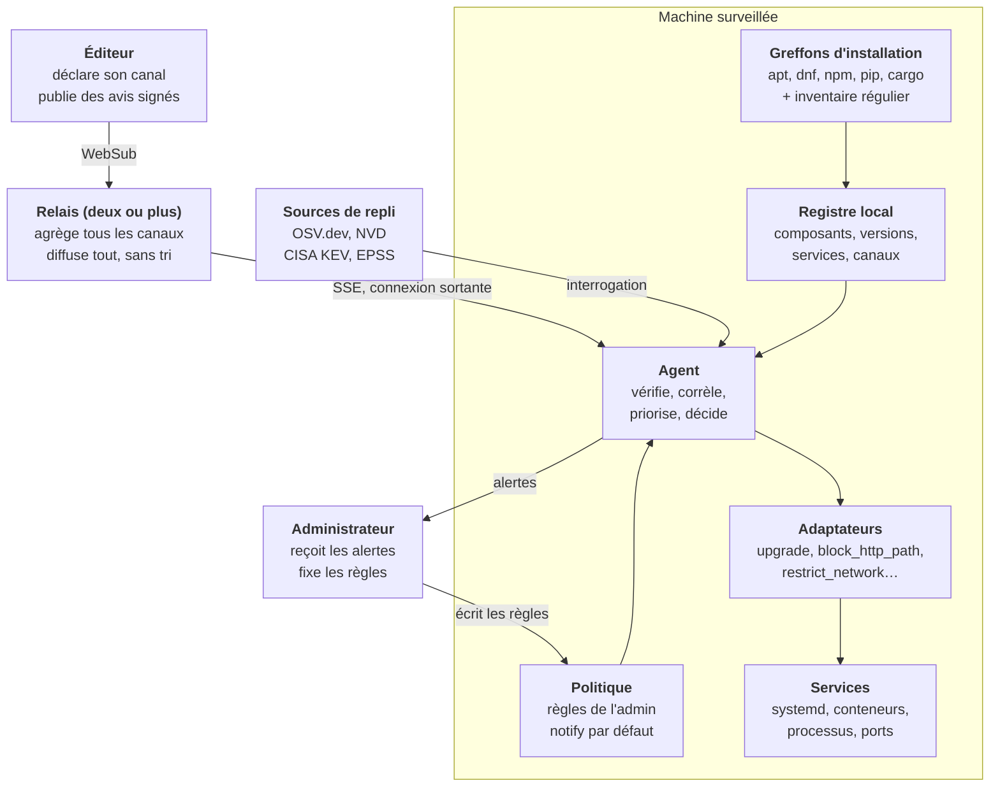

# Tocsin — Spécification v0.1 (brouillon)

Statut : brouillon de travail · 20 novembre 2026 · Licence : [CC-BY-4.0](LICENSE)

## 1. Résumé et motivation

Tocsin permet à chaque logiciel de déclarer, dès son installation, où publier ses alertes de sécurité. Un agent local s'y abonne, reçoit l'alerte en quelques secondes et réagit selon une politique fixée par l'administrateur. L'objectif est de défendre à vitesse machine, et plus à vitesse humaine.

**Le problème.** Une faille critique publiée peut désormais être exploitée en masse en quelques minutes, par des attaquants équipés d'agents IA qui lisent l'avis, écrivent l'exploit et balayent Internet. En face, la chaîne de défense reste humaine : lire une liste de diffusion, comprendre si l'on est concerné, trouver la machine, corriger.

**Ce qui manque aujourd'hui.**

- Aucun lien standard entre un logiciel installé et le canal où son éditeur publie ses alertes.
- Aucune machine ne sait, de façon lisible, quels composants elle fait tourner et quel service les utilise.
- Les avis décrivent la faille, rarement une parade applicable automatiquement.
- Les outils actuels (scanners, bases de failles) sont consultés périodiquement : l'information est tirée, pas poussée.

**Ce que Tocsin apporte.** Une couche fine au-dessus des standards existants (purl, OSV, CSAF, VEX, CycloneDX, WebSub, Sigstore) qui définit quatre choses : la déclaration du canal, le registre local, le protocole de l'agent et un format d'atténuation lisible par machine.

## 2. Terminologie et conventions

Les mots **DOIT**, **NE DOIT PAS**, **DEVRAIT** et **PEUT** ont le sens des mots MUST, MUST NOT, SHOULD et MAY de la [RFC 2119](https://www.rfc-editor.org/rfc/rfc2119).

| Terme | Définition |
| --- | --- |
| Composant | Toute unité logicielle installée : paquet système, bibliothèque, image de conteneur, firmware. |
| purl | Identifiant universel d'un composant ([spécification purl](https://github.com/package-url/purl-spec)), par exemple `pkg:npm/lodash@4.17.20`. |
| Éditeur | Celui qui publie le composant et ses avis de sécurité. |
| Avis | Message décrivant une faille, les versions touchées, le correctif et les atténuations. |
| Canal | Point de publication des avis d'un éditeur : un flux plus, optionnellement, un point de notification poussée. |
| Déclaration | Métadonnée embarquée dans le composant qui indique son canal. |
| Relais | Service qui agrège et redistribue les avis de nombreux canaux. |
| Registre local | Base présente sur chaque machine : composants, versions, services qui les utilisent, canaux. |
| Agent | Processus local qui s'abonne aux canaux, corrèle les avis avec le registre et applique la politique. |
| Politique | Règles fixées par l'administrateur : quelles alertes déclenchent quelle réaction automatique. |
| Atténuation | Action technique qui réduit le risque sans correctif : désactiver un module, bloquer un chemin, fermer un port. |

## 3. Principes de conception

Six principes guident chaque choix de la spécification ; en cas de conflit, l'ordre de la liste fait foi.

1. **La confiance se vérifie.** Tout avis qui déclenche une action automatique DOIT être signé et vérifiable. Un agent de sécurité ne doit jamais devenir une nouvelle surface d'attaque.
2. **Pousser d'abord, tirer en secours.** La notification poussée est le chemin normal ; la relecture du flux sert au rattrapage.
3. **Réutiliser plutôt qu'inventer.** Tocsin ne redéfinit ni l'identifiant de composant (purl), ni la description de faille (OSV, CSAF), ni l'inventaire (CycloneDX, SPDX). Il définit seulement ce qui manque.
4. **Utile dès le premier jour.** Sans aucune déclaration d'éditeur, l'agent fonctionne déjà grâce aux sources publiques (OSV.dev, NVD, CISA KEV). Chaque déclaration ajoutée rend le système plus rapide et plus précis.
5. **L'humain fixe les règles, la machine exécute.** Aucune action automatique hors de la politique écrite par l'administrateur. Toute action est journalisée et réversible.
6. **Peu de bruit.** Une alerte n'est envoyée que si un composant réellement installé, dans une version touchée, est utilisé par un service. Le reste va au journal.

## 4. Architecture d'ensemble

Quatre rôles se partagent le travail : l'éditeur publie, les relais redistribuent, le registre local sait ce qui tourne, l'agent décide et agit. Toutes les connexions de la machine sont sortantes.



Les avis vont de l'éditeur aux relais par WebSub, puis des relais à l'agent par une connexion que l'agent ouvre lui-même. Les sources de repli prennent le relais quand aucun canal n'est déclaré. L'administrateur intervient en amont, en écrivant la politique, et en aval, en recevant les alertes.

## 5. Déclaration du canal d'alerte

Un composant déclare son canal avec un objet `tocsin` de quelques champs, placé dans le manifeste que son écosystème lit déjà. Aucun outil nouveau n'est nécessaire côté éditeur.

### 5.1 Objet de déclaration

```json
{
  "tocsin": {
    "spec": "0.1",
    "feed": "https://security.example.org/tocsin/feed.json",
    "push": "https://security.example.org/tocsin/hub",
    "signer": {
      "issuer": "https://token.actions.githubusercontent.com",
      "identity": "https://github.com/example/widget/.github/workflows/advisory.yml@refs/heads/main"
    },
    "contact": "mailto:security@example.org"
  }
}
```

| Champ | Statut | Rôle |
| --- | --- | --- |
| `spec` | DOIT | Version de la spécification Tocsin. |
| `feed` | DOIT | URL HTTPS du flux d'avis (section 7). |
| `push` | PEUT | URL du point de notification poussée (WebSub). Absent : l'agent relit le flux. |
| `signer` | DEVRAIT | Identité attendue du signataire des avis (Sigstore, signature sans clé). Absent : aucun avis de ce canal ne peut déclencher d'action automatique. |
| `contact` | PEUT | Contact pour signaler une faille, complémentaire de `security.txt`. |

L'identifiant du composant n'est pas répété : l'agent le déduit du manifeste sous forme de purl.

### 5.2 Emplacements par écosystème

| Écosystème | Emplacement |
| --- | --- |
| npm | Champ `tocsin` dans `package.json` |
| Python | Table `[tool.tocsin]` dans `pyproject.toml`, recopiée dans les métadonnées du paquet installé |
| Rust | Table `[package.metadata.tocsin]` dans `Cargo.toml` |
| Images OCI (Docker) | Annotations `org.tocsin.feed`, `org.tocsin.push`, `org.tocsin.signer.issuer`, `org.tocsin.signer.identity` |
| Paquets système (deb, rpm) | Fichier `/usr/share/tocsin/<nom-du-paquet>.json` installé par le paquet |
| Firmware, binaire isolé | Fichier `tocsin.json` livré à côté du binaire, ou déclaration au niveau de l'éditeur (5.3) |

### 5.3 Déclaration au niveau de l'éditeur

Un éditeur PEUT publier `https://<domaine>/.well-known/tocsin.json` qui associe ses produits (motifs de purl) à ses canaux. C'est la voie pour les équipements sans gestionnaire de paquets (routeurs, points d'accès) et pour les éditeurs qui ne veulent pas modifier chaque paquet.

### 5.4 Règles

- `feed` et `push` DOIVENT utiliser HTTPS.
- Une déclaration embarquée dans un composant NE DOIT PAS pouvoir élargir les droits de l'agent : elle indique où écouter, jamais quoi exécuter.
- En cas de conflit entre la déclaration du composant et celle de l'éditeur, l'agent DEVRAIT préférer celle dont le signataire est vérifiable, et signaler le conflit.
- Les dépendances indirectes n'ont rien à déclarer chez leur parent : l'agent les découvre par les fichiers de verrouillage (section 8).

## 6. Format des avis

Un avis Tocsin est un avis au [format OSV](https://ossf.github.io/osv-schema/), sans modification, auquel s'ajoute une extension `tocsin` dans le champ `database_specific` prévu par OSV. Un outil qui ignore Tocsin lit donc l'avis comme un avis OSV ordinaire.

Les canaux PEUVENT aussi publier au format [CSAF 2.0](https://docs.oasis-open.org/csaf/csaf/v2.0/csaf-v2.0.html). Ses remédiations de catégorie `mitigation` et `workaround` correspondent alors aux atténuations ci-dessous.

### 6.1 Exemple

```json
{
  "schema_version": "1.6.0",
  "id": "EXAMPLE-2026-0042",
  "aliases": ["CVE-2026-12345"],
  "modified": "2026-11-20T08:14:00Z",
  "published": "2026-11-20T08:00:00Z",
  "summary": "Exécution de code à distance via le module d'import",
  "affected": [{
    "package": { "purl": "pkg:npm/example-widget" },
    "ranges": [{ "type": "SEMVER", "events": [{ "introduced": "2.0.0" }, { "fixed": "2.4.7" }] }]
  }],
  "database_specific": {
    "tocsin": {
      "urgency": "critical",
      "exploited": true,
      "network_reachable": true,
      "mitigations": [
        { "type": "upgrade", "to": "2.4.7" },
        { "type": "block_http_path", "pattern": "/api/import*" },
        { "type": "stop_service", "when": "no_other_mitigation" }
      ]
    }
  }
}
```

### 6.2 Champs de l'extension

| Champ | Statut | Rôle |
| --- | --- | --- |
| `urgency` | DOIT | `critical`, `high`, `medium` ou `low`, fixé par l'éditeur. L'agent PEUT le réévaluer avec CVSS, EPSS et KEV. |
| `exploited` | DEVRAIT | `true` si une exploitation réelle est connue. |
| `network_reachable` | PEUT | `true` si la faille est exploitable à distance sans authentification. |
| `mitigations` | DEVRAIT | Liste ordonnée d'atténuations, de la plus préférable à la plus radicale. |

### 6.3 Vocabulaire d'atténuation

Les atténuations sont **déclaratives** : elles disent quoi obtenir, jamais comment. Un avis NE DOIT PAS contenir de commande ni de script, et un agent NE DOIT PAS en exécuter. Chaque type correspond à un adaptateur local de l'agent, écrit et audité une fois.

| Type | Paramètres | Effet attendu |
| --- | --- | --- |
| `upgrade` | `to` | Installer la version corrigée. |
| `block_http_path` | `pattern` | Refuser ce chemin au niveau du proxy inverse ou du pare-feu applicatif. |
| `block_port` | `port`, `protocol` | Fermer l'accès réseau entrant à ce port. |
| `disable_feature` | `setting`, `value` | Changer un réglage nommé par l'éditeur, via un adaptateur fourni par celui-ci. |
| `restrict_network` | `scope` | Limiter le service au réseau local ou à une liste d'adresses. |
| `stop_service` | `when` | Arrêter le service qui charge le composant. Dernier recours. |

Un type inconnu de l'agent est ignoré et signalé à l'administrateur ; il ne bloque pas les autres.

## 7. Distribution

Les éditeurs publient un flux et notifient les relais par WebSub. Les agents ouvrent une connexion sortante permanente vers un relais et filtrent localement. Cette séparation règle deux problèmes : les machines derrière un NAT ne peuvent pas recevoir de rappel entrant, et un agent qui s'abonnerait composant par composant révélerait son inventaire.

### 7.1 Flux de l'éditeur

Le flux (`feed`) est un document JSON qui liste les avis du canal, du plus récent au plus ancien :

```json
{
  "tocsin_feed": "0.1",
  "updated": "2026-11-20T08:14:00Z",
  "advisories": [
    {
      "id": "EXAMPLE-2026-0042",
      "modified": "2026-11-20T08:14:00Z",
      "url": "https://security.example.org/tocsin/EXAMPLE-2026-0042.json",
      "sha256": "<empreinte de l'avis>",
      "bundle": "https://security.example.org/tocsin/EXAMPLE-2026-0042.sigstore.json"
    }
  ]
}
```

- Le flux DOIT accepter les requêtes conditionnelles (`ETag`, `If-Modified-Since`) pour que la relecture fréquente reste peu coûteuse.
- Chaque avis DEVRAIT être accompagné de sa signature Sigstore (`bundle`).
- Un flux Atom ou RSS PEUT être publié en parallèle pour les lecteurs humains ; il n'est pas normatif.

### 7.2 Notification poussée éditeur vers relais

Quand `push` est déclaré, l'éditeur notifie son point [WebSub](https://www.w3.org/TR/websub/) à chaque nouvel avis ou modification. Les relais s'y abonnent. La notification ne transporte que l'identifiant, l'URL et l'empreinte : le contenu est toujours récupéré puis vérifié.

### 7.3 Relais vers agent

- L'agent ouvre une connexion sortante permanente (Server-Sent Events sur HTTPS) vers un ou plusieurs relais.
- Le relais diffuse **tous** les avis, ou tous ceux d'un écosystème. L'agent NE DOIT PAS envoyer son inventaire au relais ; le tri se fait sur la machine.
- Un relais n'est jamais une source de confiance : l'agent vérifie chaque avis contre le signataire déclaré du canal (section 10).
- L'agent DEVRAIT se connecter à au moins deux relais indépendants, pour qu'un relais tombé ou malveillant ne puisse pas retenir une alerte.

### 7.4 Rattrapage

Au démarrage, après une coupure, puis périodiquement, l'agent relit directement les flux des canaux de son registre et les sources de repli (section 11). La relecture périodique est un filet de sécurité ; son intervalle est un réglage de l'agent.

## 8. Registre local

Le registre répond à une question : « quel composant, dans quelle version, est utilisé par quel service, et où écouter ses alertes ? ». Il est alimenté à l'installation quand c'est possible, et par des inventaires réguliers de l'agent dans tous les cas.

### 8.1 Emplacement

| Système | Base | Déclarations et inventaires déposés |
| --- | --- | --- |
| Linux, BSD | `/var/lib/tocsin/registry.db` | `/etc/tocsin/declarations.d/`, `/etc/tocsin/sbom.d/` |
| macOS | `/Library/Application Support/Tocsin/registry.db` | `/Library/Application Support/Tocsin/declarations.d/` |
| Windows | `%ProgramData%\Tocsin\registry.db` | `%ProgramData%\Tocsin\declarations.d\` |

Le format de la base est interne à l'agent. Ce qui est normatif, ce sont les répertoires de dépôt et l'export du registre au format CycloneDX, pour que d'autres outils puissent le lire.

### 8.2 Contenu

| Entité | Informations |
| --- | --- |
| Composant | purl, version, origine (paquet système, fichier de verrouillage, image, inventaire déposé), chemin |
| Canal | `feed`, `push`, `signer`, origine de la déclaration (composant ou éditeur) |
| Service | type (unité systemd, conteneur, processus, tâche planifiée), nom, ports ouverts, exposition (locale ou Internet) |
| Utilisation | lien composant vers service, avec la preuve (bibliothèque chargée en mémoire, fichier de l'image, dépendance du projet) |
| Journal | avis reçus, décisions, actions appliquées et leur annulation |

### 8.3 Alimentation

1. **À l'installation** : des greffons pour les gestionnaires de paquets (apt, dnf, npm, pip, cargo) DEVRAIENT notifier l'agent après chaque installation ou mise à jour. Ils déposent la déclaration lue dans le manifeste ; ils n'exécutent rien d'autre.
2. **Inventaire régulier** : l'agent DOIT lire lui-même les bases des gestionnaires de paquets, les images des conteneurs actifs, et les fichiers de verrouillage (`package-lock.json`, `poetry.lock`, `Cargo.lock`…) des répertoires que l'administrateur lui désigne. C'est ce qui couvre les dépendances indirectes et les installations faites sans greffon.
3. **Lien avec les services** : l'agent relie les composants aux services en lisant les bibliothèques chargées par les processus, les unités systemd, les conteneurs et leurs images, et les ports en écoute.
4. **Dépôt manuel** : un SBOM CycloneDX ou SPDX déposé dans `sbom.d/` est intégré tel quel. C'est la voie pour les logiciels propriétaires et les équipements distants.

## 9. Agent

Pour chaque avis reçu, l'agent vérifie, corrèle, priorise, décide selon la politique, agit, puis informe. Par défaut, il ne fait qu'informer : toute action automatique est un choix explicite de l'administrateur.

### 9.1 Chaîne de traitement

1. **Vérifier** la signature de l'avis contre le `signer` du canal. Échec : l'avis est journalisé comme suspect et ne peut que notifier.
2. **Corréler** : comparer les plages de versions de l'avis aux composants du registre. Aucune correspondance : journal uniquement.
3. **Situer** : pour chaque composant touché, lister les services qui l'utilisent, leurs ports et leur exposition.
4. **Prioriser** (9.2).
5. **Décider** selon la première règle de la politique qui s'applique (9.3).
6. **Agir** : appliquer les atténuations autorisées, dans l'ordre de l'avis, et s'arrêter à la première qui réussit.
7. **Informer** (9.4).

### 9.2 Priorité effective

L'agent part de l'`urgency` de l'éditeur, puis ajuste :

- **Relève à `critical`** si la faille figure au catalogue [CISA KEV](https://www.cisa.gov/known-exploited-vulnerabilities-catalog) ou si `exploited` vaut `true`.
- **Relève d'un cran** si un service touché est exposé à Internet et que `network_reachable` vaut `true`, ou si le score [EPSS](https://www.first.org/epss/) dépasse un seuil réglable.
- **Abaisse d'un cran** si le composant est installé mais utilisé par aucun service actif.
- **Ne notifie pas** si un document VEX de l'éditeur déclare la configuration non touchée.

### 9.3 Politique

La politique est un fichier écrit par l'administrateur (`/etc/tocsin/policy.toml`). Les règles sont lues dans l'ordre ; la première qui s'applique l'emporte.

```toml
[[rule]]
name    = "Critique, exploitée, exposée"
when    = { priority = ["critical"], exposure = "internet", signed = true }
action  = "mitigate"
allow   = ["upgrade", "block_http_path", "restrict_network"]
notify  = ["email:admin", "webhook:astreinte"]

[[rule]]
name    = "Critique interne"
when    = { priority = ["critical"] }
action  = "propose"   # prépare l'action, attend une confirmation
notify  = ["email:admin"]

[[rule]]
name    = "Par défaut"
action  = "notify"
notify  = ["digest:quotidien"]
```

- Actions possibles : `log`, `notify`, `propose`, `mitigate`.
- La politique livrée par défaut DOIT être `notify` seule.
- `mitigate` exige un avis signé et vérifié, et n'utilise que les types listés dans `allow`.
- Toute atténuation appliquée DOIT être réversible par une commande unique (`tocsin undo <id>`), et DEVRAIT être retirée automatiquement une fois la version corrigée installée.

### 9.4 Contenu d'une alerte

Chaque alerte répond, dans cet ordre : quoi (faille, priorité, exploitation connue), où (machine, service, port, composant et version), preuve (comment le lien a été établi), ce qui a été fait (ou proposé), et comment l'annuler.

> CRITIQUE · CVE-2026-12345 (exploitée) · example-widget 2.3.1 utilisé par le service `portail-web` (conteneur, port 443, exposé Internet) sur srv-web-01. Chemin `/api/import*` bloqué sur le proxy à 08:00:41. Correctif : 2.4.7. Annuler : `tocsin undo a7f3`.

## 10. Sécurité et modèle de menace

Le risque principal n'est pas qu'une alerte arrive en retard. C'est que Tocsin lui-même serve à couper des services à distance ou à masquer une vraie faille. Les contre-mesures ci-dessous sont normatives.

| Menace | Scénario | Contre-mesure |
| --- | --- | --- |
| Faux avis | Un attaquant publie un avis qui pousse les agents à arrêter un service (déni de service à grande échelle). | Seul un avis signé par le `signer` déclaré peut déclencher `mitigate`. `stop_service` est absent de toute politique par défaut. |
| Canal qui déborde de son périmètre | Un paquet malveillant déclare un canal, puis publie des avis visant d'autres composants. | Un canal n'est cru que pour les purl qui l'ont déclaré. Un avis hors périmètre ne peut que notifier. |
| Alerte retenue | Un relais malveillant ou en panne ne transmet pas un avis. | Au moins deux relais indépendants, relecture directe des flux, sources de repli (section 11). |
| Rejeu | Un ancien avis, déjà traité, est renvoyé pour relancer une action. | La signature couvre `id` et `modified`. L'agent ignore tout avis qui n'est pas plus récent que celui qu'il connaît. |
| Compte éditeur compromis | L'attaquant signe de vrais-faux avis avec l'identité de l'éditeur. | Signatures inscrites au journal de transparence Sigstore (Rekor), donc visibles et surveillables. Limite du nombre d'actions automatiques par période. |
| Fuite d'inventaire | Un relais déduit les logiciels vulnérables de chaque machine à partir de ses abonnements. | Diffusion complète par le relais, tri local, aucun inventaire envoyé (7.3). |
| Agent compromis | L'agent, qui a des droits élevés, devient la cible. | Séparation des privilèges : cœur sans privilège, adaptateurs d'atténuation minimaux et isolés. Implémentation de référence dans un langage sûr pour la mémoire. |

**Divulgation.** Tocsin ne change pas le calendrier de divulgation : un avis publié sur un canal est public, comme sur une liste de diffusion. L'embargo reste géré en amont, entre chercheurs et éditeurs. L'apport de Tocsin est que les défenseurs reçoivent l'avis au même instant que les attaquants, et sous une forme directement actionnable.

## 11. Repli et compatibilité

Un composant sans déclaration reste surveillé : l'agent interroge les bases publiques à partir de son purl. C'est ce qui rend Tocsin utile avant toute adoption par les éditeurs.

| Source | Apport | Usage par l'agent |
| --- | --- | --- |
| [OSV.dev](https://osv.dev/) | Avis au format OSV pour npm, PyPI, crates.io, Go, Maven, Debian, Ubuntu, Alpine et d'autres | Source de repli principale, interrogée par lot à partir des purl du registre |
| [NVD](https://nvd.nist.gov/) | Fiches CVE avec score CVSS et identifiants de produits (CPE) | Composants hors écosystèmes de paquets : firmware, logiciels propriétaires |
| [CISA KEV](https://www.cisa.gov/known-exploited-vulnerabilities-catalog) | Liste des failles exploitées activement | Relèvement de priorité (9.2) |
| [EPSS](https://www.first.org/epss/) | Probabilité d'exploitation à 30 jours | Relèvement de priorité (9.2) |
| Avis des distributions (Debian, Ubuntu, Red Hat…) | Versions corrigées propres à chaque distribution | Éviter les fausses alertes sur les paquets corrigés par rétroportage |

**Règles.**

- Un avis issu d'une source de repli est traité comme non signé par l'éditeur : il peut notifier ou proposer, et déclencher `mitigate` seulement si la politique l'autorise explicitement pour cette source.
- Quand un composant a un canal déclaré, les sources de repli servent de recoupement : un avis présent dans OSV mais absent du canal est signalé.
- La version d'un paquet de distribution DOIT être comparée aux avis de cette distribution, pas aux versions amont : un paquet Debian corrigé garde souvent son numéro de version amont.

## 12. Questions ouvertes et feuille de route

La v0.1 fixe les principes et les formats. Les questions ci-dessous doivent être tranchées avant une v1.0.

### 12.1 Questions ouvertes

- [ ] **Espace de noms** : le préfixe des annotations OCI (`org.tocsin.*`) suppose de détenir le domaine correspondant.
- [ ] **Langue de référence** : la spécification publique devra être en anglais pour viser l'adoption internationale.
- [ ] **Format du flux** : JSON propre à Tocsin, ou réutilisation du format de flux défini par CSAF (ROLIE) ?
- [ ] **Gouvernance des relais** : qui les opère, comment un agent choisit-il des relais indépendants ?
- [ ] **Adaptateurs `disable_feature`** : comment un éditeur livre-t-il un adaptateur fiable sans ouvrir une porte à l'exécution de code ?
- [ ] **Équipements sans agent** (routeurs, points d'accès) : surveillance à distance par un agent tiers, et format d'inventaire associé.
- [ ] **Seuils par défaut** : seuil EPSS, nombre maximal d'actions automatiques par heure, intervalle de relecture des flux.

### 12.2 Feuille de route

1. **v0.1, brouillon** (ce document) : relecture, retours.
2. **Implémentation de référence en Rust** : agent Linux avec inventaire (paquets, conteneurs, fichiers de verrouillage), lien avec les services, repli OSV et KEV, politique `notify` et `propose`.
3. **Premiers canaux** : déclarations ajoutées à quelques projets open source volontaires, un relais de démonstration.
4. **Atténuations automatiques** : adaptateurs `upgrade`, `block_http_path` et `restrict_network`, avec annulation.
5. **Portée institutionnelle** : proposition à l'[OpenSSF](https://openssf.org/), qui héberge déjà OSV et Sigstore ; puis brouillon IETF si l'adoption suit.

**Levier réglementaire.** Le [Cyber Resilience Act](https://eur-lex.europa.eu/eli/reg/2024/2847/oj) européen impose aux fabricants de traiter et signaler les vulnérabilités de leurs produits et de diffuser des mises à jour de sécurité. Tocsin peut être présenté comme un moyen simple et ouvert d'y répondre. Les dates d'application exactes sont à confirmer dans le texte.
